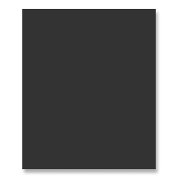
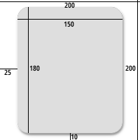
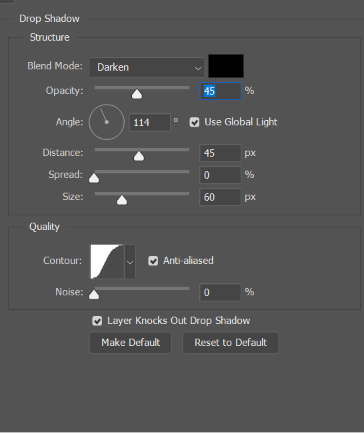
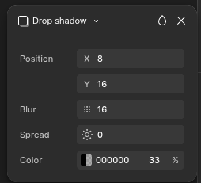
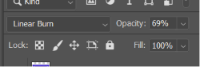
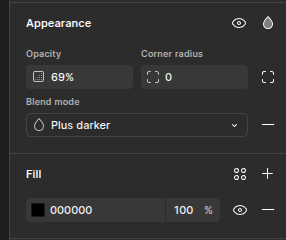

# Audio Plugin Documentation for Darkglass Anagram

This document contains basic guidelines for block images.

The basic requirements are:

 1. Block Image in ON state: 200x200px and 800x800px
 2. Block Image in OFF state: 200x200px

The 200x200px images are used directly in the Anagram while 800x800px are for the marketplace.

#### Optional assets

 1. Animated switching/transition between ON and OFF states on the Anagram
    - requires an additional block image spritesheet
 2. Animated element in the block image (such as showing gain reduction amount in the block image of a compressor)
    - this requires an additional spritesheet of the dynamic element

See [STYLING.md](STYLING.md) for more details.

#### Suggested process

 1. Design high res block image in 800x800px
 2. Export high-res image to PNG
 3. Scale down to anagram-res block image at 200x200px
 4. Export anagram-res image to PNG

## Guidelines

#### Size and shape for 800px

 1. Height and Width of the resulting .png asset should be 800x800px
 2. There should be 100px of spacing between the Block and the sides of the asset
    - This means that the width of the actual block (excluding shadows) should be 600px
    - Shadows are allowed in the 100px of spacing
 3. There should be 40px of spacing between the Block and the top and bottom of the asset
    - This means that the height of the actual block (excluding shadows) should be 720px
    - Shadows are allowed in the 40px of spacing
 4. Summarized: the Block should be 600x720px, centered inside of a 800x800px asset
 5. Sidenote: most blocks use a corner radius of 64

If you would like your block to use a shape other than a rectangle with an optional small corner radius applied, please check with the Darkglass team.

#### Size and shape for 200px

All values from 800px variant divided by 4

 1. Height and width of the resulting .png asset should be 200x200px
 2. There should be 25px of spacing between the Block and the sides of the asset
    - This means that the width of the actual block (excluding shadows) should be 150px
    - Shadows are allowed in the 25px of spacing
 3. There should be 10px of spacing between the Block and the top and bottom of the asset
    - This means that the height of the actual block (excluding shadows) should be 180px
    - Shadows are allowed in the 10px of spacing
 4. Summarized: the Block should be 150x180px, centered inside of a 200x200px asset
 5. Sidenote: most blocks use a corner radius of 16

If you would like your block to use a shape other than a rectangle with an optional small corner radius applied, please check with the Darkglass team.

 

### Shadows

A drop-shadow should be applied to all variants of the block image.

In order to match the official Darkglass blocks, use the following settings (for the 800px block images):

 - Photoshop:
   - Blend mode = darken
   - opacity = 45%
   - color = #000000
   - angle = 114 deg
   - distance = 45px
   - spread = 0%
   - size = 60px
   - anti aliasing = on
   - noise = 0%
 - Figma:
   - x = 8
   - y = 16
   - blur = 16
   - spread = 0
   - color = #000000
   - opacity = 33%

 

### Difference between ON and OFF states

 1. If there is an LED, Display, Meter, or similar element in the block image, it should be turned off in the OFF state
 2. The OFF state of the block image should always have a darkening layer applied to it

In order to match the OFF state of original Darkglass blocks, use the following settings:
 - Photoshop:
   - blend mode = linear burn
   - opacity = 69%
   - color = #000000
 - Figma:
   - blend mode = plus darker
   - opacity = 69%
   - color = #000000

 
